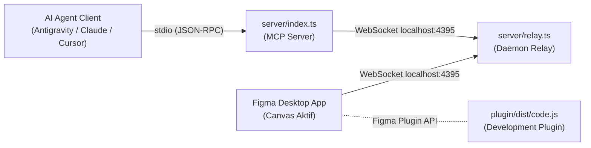

# 🎨 Figma Bridge MCP (`figma-bridge`)

[](LICENSE)
[](https://bun.sh)
[](#)
[](https://figma.com)

**Figma Bridge** adalah Model Context Protocol (MCP) Server dan Figma Plugin yang memberikan AI Agent (Google Antigravity, Claude Code, Cursor, Windsurf, Claude Desktop) akses **baca dan tulis (read & write)** dua arah penuh ke aplikasi **Figma Desktop** melalui Figma Plugin API.

Berbeda dengan MCP bawaan Figma yang hanya membaca desain ke kode (*read-only*), **Figma Bridge** bekerja dua arah: AI Agent dapat menelusuri hierarki node (*tree*), membuat frame, mengatur Auto Layout, membuat dan mengedit teks dengan auto font-preloading, mengubah warna, stroke, dan drop shadow, mengimpor komponen, mengambil screenshot kanvas, serta menjalankan kode JavaScript arbitrer di konteks Figma Plugin API.

Seluruh komunikasi berjalan lokal di mesin Anda (`127.0.0.1:4395`) tanpa data kanvas yang bocor ke cloud pihak ketiga.

---

## 🚀 Quick Start untuk AI Agent (1-Click)

Jika Anda ingin AI Agent Anda yang melakukan setup otomatis dari nol di mesin atau laptop baru, cukup salin instruksi di file:
👉 **[`PROMPT_COPAS_AI_AGENT.md`](./PROMPT_COPAS_AI_AGENT.md)**

Kirim prompt tersebut ke AI Agent Anda, dan agent akan otomatis menginstall dependencies, menjalankan relay, mendaftarkan config MCP, serta memandu Anda mengimpor plugin di Figma.

---

## 🏗️ Arsitektur Sistem



- **`server/index.ts`**: MCP server berbasis stdio yang berkomunikasi dengan client LLM. Menerjemahkan setiap tool call menjadi pesan WebSocket ke relay.
- **`server/relay.ts`**: Daemon relay ringan pada port `ws://127.0.0.1:4395`. Berjalan mandiri di latar belakang sehingga beberapa sesi AI agent dapat berbagi satu koneksi kanvas aktif tanpa `EADDRINUSE`.
- **`plugin/`**: Figma plugin yang berjalan di Figma Desktop. Terhubung ke relay WebSocket lokal, mengeksekusi aksi kanvas via Plugin API, dan mengembalikan hasil ke agent. Plugin memiliki fitur auto-reconnect jika relay di-restart.

---

## 📋 Persyaratan

1. **[Bun](https://bun.sh)** v1.1 atau yang lebih baru.
2. **Aplikasi Figma Desktop** (Linux, macOS, atau Windows). *Plugin development memerlukan aplikasi Desktop; browser web Figma membatasi akses WebSocket lokal.*
3. Hak edit (*edit access*) pada file Figma yang sedang dibuka.

---

## ⚡ Instalasi Cepat (Otomatis)

Jalankan skrip setup interaktif:
```bash
git clone https://github.com/arstate/figma-bridge.git
cd figma-bridge
chmod +x setup.sh
./setup.sh
```

Skrip `setup.sh` akan:
1. Memeriksa runtime Bun.
2. Memeriksa dependensi server (`bun install`).
3. Memverifikasi bundle plugin (`plugin/dist/code.js`).
4. Memastikan relay daemon berjalan di background pada port `4395`.
5. Menjalankan MCP smoke test.
6. Menampilkan path absolut file manifest plugin untuk diimpor ke Figma.

---

## 🔌 Setup Manual Langkah Demi Langkah

### 1. Daftarkan Plugin di Figma Desktop
1. Buka aplikasi **Figma Desktop** dan buka file/project Anda.
2. Klik menu utama Figma (ikon logo di kiri atas) -> **Plugins** -> **Development** -> **Import plugin from manifest...**.
3. Navigasikan ke repositori ini dan pilih file: `plugin/manifest.json`.
4. Jalankan plugin: Klik kanan di kanvas -> **Plugins** -> **Development** -> **figma-bridge**.
5. Jendela plugin kecil akan muncul dan menampilkan status: `Connected to relay`.

### 2. Mulai WebSocket Relay Daemon
```bash
bun server/relay.ts
```
*(Atau biarkan server MCP menjalankannya secara otomatis pada panggilan tool pertama).*

### 3. Konfigurasi MCP Client

Tambahkan konfigurasi berikut ke MCP client pilihan Anda:

#### A. Google Antigravity (`~/.gemini/antigravity/mcp_config.json`)
```json
{
  "mcpServers": {
    "figma-bridge": {
      "command": "bun",
      "args": ["/ABSOLUTE/PATH/TO/figma-bridge/server/index.ts"]
    }
  }
}
```

#### B. Claude Desktop
- **Linux:** `~/.config/Claude/claude_desktop_config.json`
- **macOS:** `~/Library/Application Support/Claude/claude_desktop_config.json`
- **Windows:** `%APPDATA%\Claude\claude_desktop_config.json`

```json
{
  "mcpServers": {
    "figma-bridge": {
      "command": "bun",
      "args": ["/ABSOLUTE/PATH/TO/figma-bridge/server/index.ts"]
    }
  }
}
```

#### C. Cursor & Windsurf (`.cursor/mcp.json`)
```json
{
  "mcpServers": {
    "figma-bridge": {
      "command": "bun",
      "args": ["/ABSOLUTE/PATH/TO/figma-bridge/server/index.ts"]
    }
  }
}
```

---

## 🧰 Katalog 30 Tools MCP

| Kategori | Tool Name | Deskripsi Singkat |
| :--- | :--- | :--- |
| **Orientasi** | `get_basic_info` | Mengambil metadata file, page aktif, daftar artboard, dan font terdeteksi. |
| | `get_guide` | Panduan alur kerja dan praktik terbaik otomasi Figma bridge. |
| | `get_selection` | Membaca node yang saat ini sedang dipilih user di kanvas. |
| | `set_selection` | Memilih node tertentu di kanvas secara terprogram. |
| **Penelusuran** | `find_nodes` | Mencari node berdasarkan nama, tipe (`FRAME`, `TEXT`, dll.), atau regex. |
| | `get_tree` | Mengambil seluruh hierarki tree node dari root page atau frame tertentu. |
| | `get_tree_summary`| Ringkasan tree kompak untuk menghemat token konteks AI. |
| | `get_node` | Membaca detail lengkap properti satu node tertentu. |
| | `get_layout` | Membaca absolute bounding box untuk kalkulasi overlap/tabrakan. |
| | `get_computed_styles`| Mengambil style terkomputasi (CSS equivalent) dari sebuah node. |
| **Mutasi Canvas** | `create_frame` | Membuat Frame atau Auto Layout (`HORIZONTAL` / `VERTICAL`). |
| | `create_text` | Membuat teks baru (mendukung font preloading otomatis). |
| | `update_text` | Memperbarui isi teks node tanpa merusak hierarki atau style. |
| | `create_svg` | Merender vektor atau ikon baru dari string SVG. |
| | `delete_node` | Menghapus node dari kanvas berdasarkan ID. |
| | `clone_node` | Menggandakan node yang ada ke posisi baru. |
| | `tidy_layout` | Merapikan susunan child node dalam Auto Layout. |
| | `set_properties` | Mengubah dimensi, padding, itemSpacing, cornerRadius, opacity. |
| | `set_fills` | Mengatur warna background (solid hex, linear/radial gradient). |
| | `set_strokes` | Mengatur border, ketebalan outline, dan warna stroke. |
| | `set_effects` | Menambahkan Drop Shadow, Inner Shadow, Layer Blur, atau Background Blur. |
| | `set_image_fill` | Mengisi node atau frame dengan gambar dari base64 atau URL. |
| | `get_fill_image` | Mengunduh data gambar asli dari node yang memiliki image fill. |
| **Page & Organisasi** | `create_page` | Membuat page baru di dalam file Figma aktif. |
| | `rename_pages` | Mengubah nama page di dalam dokumen. |
| | `import_component`| Mengimpor komponen dari library tim yang tersedia. |
| **Inspeksi & Visual**| `get_screenshot` | Mengambil screenshot raster PNG dari viewport atau node tertentu. |
| | `export_node` | Mengekspor node ke format PNG, SVG, JPG, atau PDF. |
| | `notify` | Menampilkan pesan toast notification di layar Figma Desktop user. |
| **Arbitrary Code** | `execute` | Menjalankan kode JavaScript Plugin API arbitrer dengan return value. |

---

## 💡 Contoh Penggunaan Arbitrer via `execute`

AI Agent dapat langsung mengeksekusi logika Figma Plugin API native:

```typescript
// Contoh: Membuat badge dengan pill background dan border tegas
await execute({
  code: `
    const frame = figma.createFrame();
    frame.name = "Badge/Status";
    frame.layoutMode = "HORIZONTAL";
    frame.paddingLeft = frame.paddingRight = 16;
    frame.paddingTop = frame.paddingBottom = 8;
    frame.cornerRadius = 999;
    frame.fills = [{ type: 'SOLID', color: { r: 0.95, g: 0.95, b: 0.95 } }];
    frame.strokes = [{ type: 'SOLID', color: { r: 0.1, g: 0.1, b: 0.1 } }];
    frame.strokeWeight = 1.5;
    
    await figma.loadFontAsync({ family: "Inter", style: "Bold" });
    const text = figma.createText();
    text.characters = "READY TO SHIP";
    text.fontSize = 12;
    frame.appendChild(text);
    return frame.id;
  `
});
```

Contoh skrip automasi batch tingkat lanjut untuk pembuatan poster, infografis A3, dan audit layout tersedia di folder:
📂 **[`examples/automation/`](./examples/automation/)**

---

## 🛠️ Troubleshooting & FAQ

### 1. `WebSocket connection to ws://127.0.0.1:4395 failed`
- **Penyebab:** Relay daemon belum berjalan.
- **Solusi:** Jalankan `./setup.sh` atau eksekusi `bun server/relay.ts` di terminal. Pastikan tidak ada firewall yang memblokir port `4395`.

### 2. `Cannot call with documentAccess: dynamic-page`
- **Penyebab:** File Figma sangat besar dan node berada di luar page aktif.
- **Solusi:** Buka halaman (*page*) tempat frame desain berada di Figma Desktop, lalu jalankan kembali perintah agent.

### 3. Font Loading Error (`The font ... has not been loaded`)
- **Solusi:** Figma mewajibkan font di-load secara asinkron sebelum memodifikasi teks. Gunakan tool bawaan `create_text` atau `update_text` yang sudah mengotomatisasi preloading font, atau jika menggunakan tool `execute`, sertakan `await figma.loadFontAsync({ family: "NamaFont", style: "Regular" })`.

### 4. Plugin Status: "Connecting..." tetapi tidak terhubung
- Pastikan Anda menggunakan **Figma Desktop App**, bukan browser web Figma.
- Buka Console Plugin via: Klik kanan jendela plugin -> **Inspect** -> Tab **Console** untuk melihat log debug.

---

## 📄 Lisensi

Didistribusikan di bawah lisensi **MIT**. Silakan gunakan, modifikasi, dan integrasikan dengan AI workflow Anda secara bebas.
